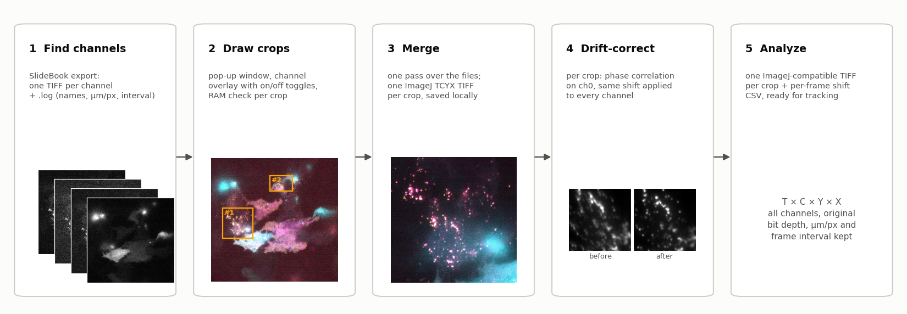
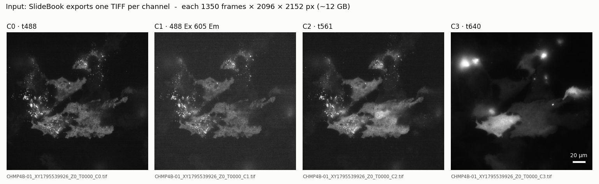
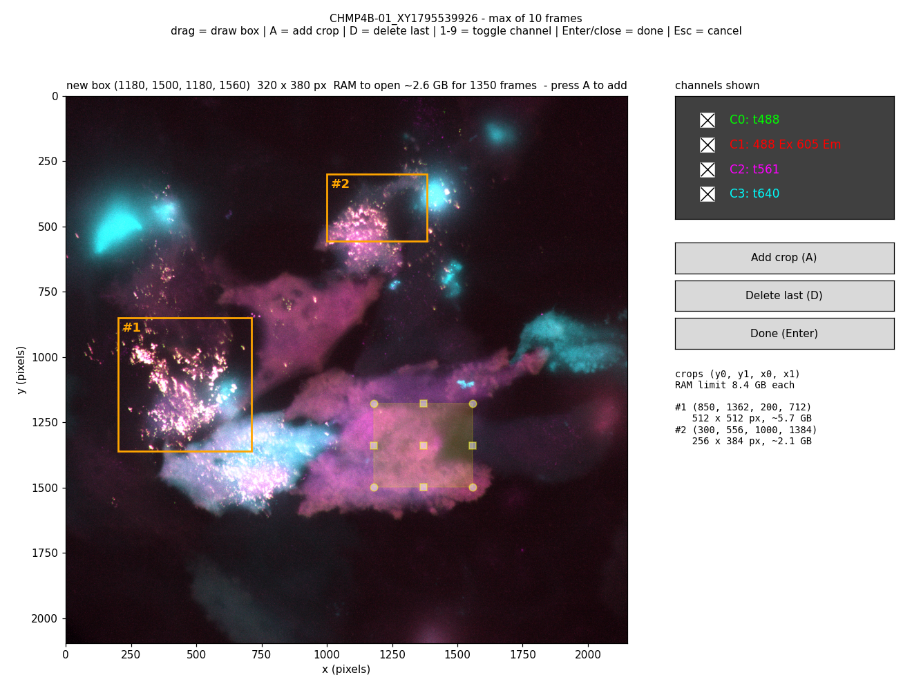
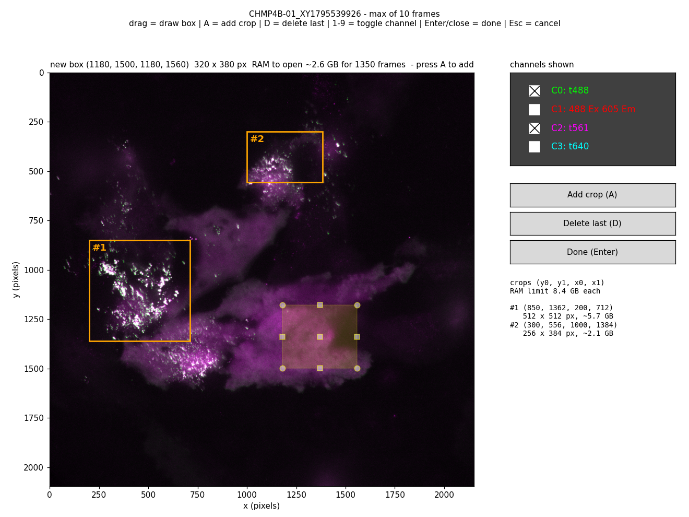
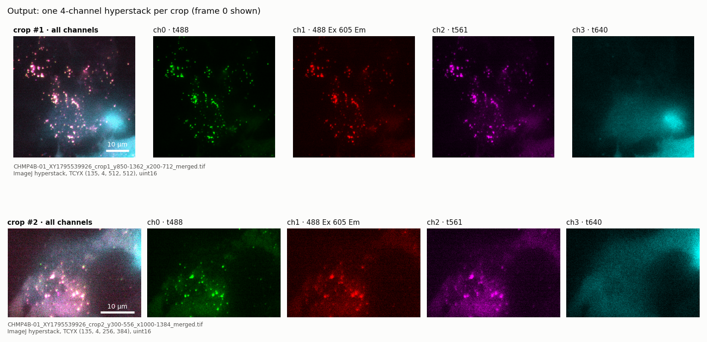
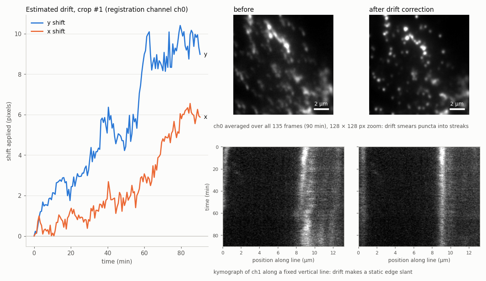

# Single-Virus-Tracking_ImageProcess
This notebook 'merge_crop_drift_correct_3i.ipynb' turns a SlideBook (Intelligent Imaging Innovations, "3i") multi-channel time-lapse export into drift-corrected, multi-channel TIFF hyperstacks that are ready for single viral particle tracking. 



## Features

- **Find channels:** groups the per-channel TIFFs (`..._C0.tif`, `..._C1.tif`, ...) by position and reads channel names, pixel size, and frame interval from the SlideBook `.log` file.
- **Draw crops:** pick any number of rectangular regions in a pop-up window. Channels are shown as a colored overlay that you can switch on and off.
- **Merge:** writes one ImageJ `TCYX` hyperstack per crop, at the original bit depth. The source files are read only once, however many crops there are.
- **Drift-correct:** corrects XY drift by phase correlation on one channel and applies the same shift to all channels. The shifts are saved as a CSV.
- **Safe:** source files are never modified, outputs are checked against the source pixels, and the merge stops before writing a crop too large to load into RAM.

## Example

Four channels, each 1350 frames of 2096 × 2152 px (~12 GB per file).

**Input:** one TIFF per channel.



**Crop selection:** saved crops are numbered; the yellow box is a new box not yet added.



**Channel toggles:** only C0 and C2 shown; overlapping signal appears white.



**Output:** one 4-channel hyperstack per crop.



**Drift correction:** estimated shift (left). Time-averaged image (top) and kymograph (bottom), before and after correction.



## Requirements

- Python 3.10+ with `numpy`, `tifffile`, and `matplotlib` (`pandas` is optional).
- Jupyter running locally (the crop window uses Tk).

## Usage

Open `merge_crop_drift_correct_3i.ipynb` and run the cells in order:

1. Set `source_folder` and `position_index`.
2. Draw crops: drag a box, press **A** to add it, **D** to delete the last one, **1-9** to toggle channels, **Enter** to finish.
3. Choose an output folder.
4. Run the merge, then drift correction.

Outputs for each crop:

```
<prefix>_crop1_y850-1362_x200-712_merged.tif                   # merged hyperstack
<prefix>_crop1_y850-1362_x200-712_merged_drift_corrected.tif   # drift-corrected
<prefix>_crop1_y850-1362_x200-712_merged_drift_shifts.csv      # shift per frame
```

## Notes

- Corrects XY translation only (no rotation or Z drift).
- SlideBook TIFFs are read frame by frame. Reading four 12 GB files from a network share takes ~30 min.
- The memory limit defaults to half of the system RAM; set `max_memory_gb=0` to turn it off.

## License

[MIT](LICENSE)
